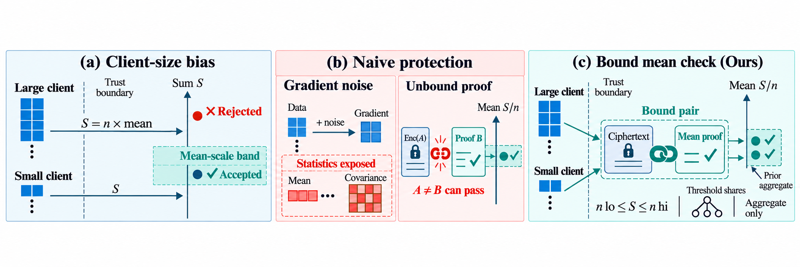
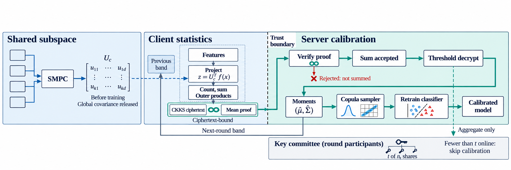
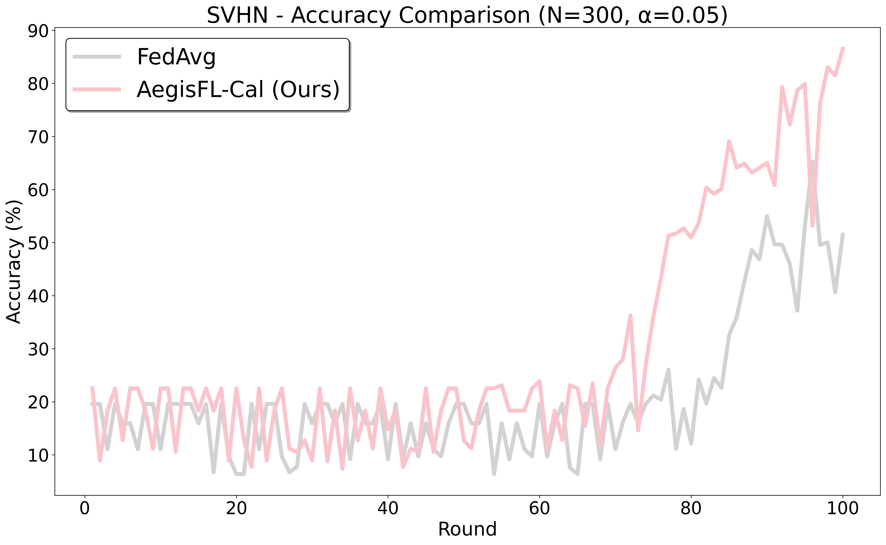

# AegisFL-Cal

**A class-conditional sum grows with how many samples a client holds, so a band on the federation mean rejects a large honest client.**

AegisFL-Cal calibrates a federated classifier from encrypted class-conditional feature statistics. Each participant proves that its *normalized mean* lies in the previous round's aggregate band and binds that proof to the CKKS plaintext. A threshold of the round's participants decrypts only the verified sum. The server then samples synthetic features from the decrypted moments and retrains.

<p align="center">
  <a href="#quick-start"><strong>Quick start</strong></a>
  &nbsp;·&nbsp;
  <a href="#layout"><strong>Layout</strong></a>
</p>

## Mean-scale check

A band written on raw sums treats a large honest client as an outlier. The protocol checks the mean, which stays on the feature scale at any sample count, and hashes the ciphertext into the proof challenge so a client cannot prove one value and encrypt another.

<p align="center">
  
</p>

## Encrypted statistics, one aggregate

Clients agree on a class-conditional subspace, encrypt projected counts, sums, and outer products, and attach a range proof on the mean. The server sums accepted ciphertexts. Calibration is skipped if fewer than the threshold of the round committee stay online.

<p align="center">
  
</p>

## Calibration under label skew

On image, text, and tabular tasks with Dirichlet label skew, the protected calibrator improves on federated averaging. Switching the cryptographic layer off recovers only a few more points. Class-wise accuracy is not uniform: some classes rise and others fall when the sampler uses Gaussian marginals.

<p align="center">
  
</p>

## Quick start

Python 3.10+ recommended. A GPU is optional.

```bash
pip install -r requirements.txt
python main.py --dataset mnist --num_clients 8 --rounds 2 \
    --strategy aegisflcal --alpha 0.05 \
    --aegisflcal_max_s_c 8 --aegisflcal_synthetic_ratio 0.5
```

TenSEAL is required for CKKS. MP-SPDZ is optional and used only for the subspace-discovery path.

## Reproduce

```bash
python main.py --dataset mnist --num_clients 300 --rounds 100 \
    --strategy aegisflcal --alpha 0.05 \
    --aegisflcal_max_s_c 15 --aegisflcal_synthetic_ratio 1.5
```

Other strategies: `fedavg`, `dpfedavg`, `ldpfl`, `acsfl`, `fedmps`. Outputs go under `results/` (not tracked).

```bash
python main.py --help
```

## Layout

```
main.py                 entry
strategies/federated/   AegisFL-Cal and baselines
models/                 networks
utils/                  crypto, loaders, copula sampler
data/                   client and server objects
docs/figures/           motivation, framework, results plates
```

## Notes

Range proofs in this tree are a working mock of the paper's acceptance predicate: the client mean against the previous-round aggregate band, with the Fiat–Shamir challenge hashed over the ciphertext bytes. The threshold among a round of 30 participants is 16. Datasets download on first use and are not stored in the repository.
